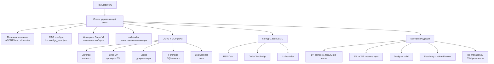
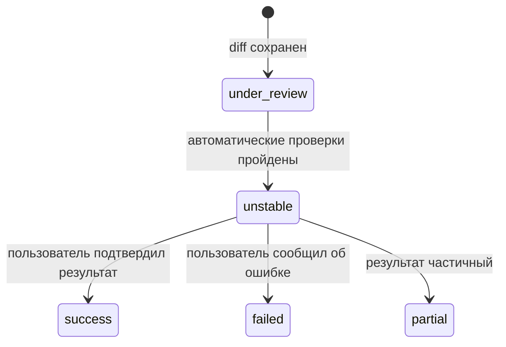

# Архитектура и эксплуатационная модель рабочей среды `epf1129`

Последняя публичная двуязычная контрольная точка: [2026-10-06 RU](WORKSPACE_CHECKPOINT_2026-10-06.md) / [EN](WORKSPACE_CHECKPOINT_2026-10-06.en.md).

## Паспорт документа

| Поле | Значение |
|---|---|
| Назначение | Передача текущей рабочей среды на анализ в проектный, архитектурный или эксплуатационный отдел |
| Статус | Актуальная проверенная спецификация; автоматический учет изменений прошел техническую приемку |
| Дата состояния | 2026-07-23 |
| Корень проекта | `{PROJECT_ROOT}` |
| Рабочий каталог Codex | `{WORKSPACE_ROOT}` |
| Среда хоста | WSL2, Linux `6.6.114.1-microsoft-standard-WSL2`, `x86_64` |
| Канонический Python | `{PROJECT_ROOT}/.venv-gemini-bridge/bin/python` |
| Версия Python | `3.12.3` |

Документ фиксирует три разных вида сведений:

- **подтверждено** — проверено локальной командой, артефактом или тестом;
- **политика** — обязательное правило работы, которое не доказывает доступность компонента;
- **историческое** — сохранено для расследований, но не является текущим состоянием.

## Дополнение: адаптивная статическая оценка BSL

Для снижения расхода токенов при подготовке BSL-черновиков используется локальный контур `scripts/eval_bsl_candidate.py`. Он запускает доступный OneScript в режиме `-check`, проверяет немедленное уничтожение временных таблиц, запрещенные BSL-конструкции и доказательную привязку статических ссылок на метаданные.

Первый кандидат является единственным fast-path: при нулевой стоимости он принимается без дополнительных модельных вызовов. Ненулевая стоимость разрешает ровно две целевые вариации; выбирается только нулевой результат с минимальной стоимостью, а при равенстве — ранняя вариация. Недоступность диагностики, незафиксированные метаданные или ненулевая стоимость после двух вариаций — STOP. Этот контур не выполняет BSL, не подключается к базам и не заменяет Designer/1С runtime-проверку.

Файл `docs/профессиональное-описание-схемы-рабочей-среды.md` от
2026-07-22 не содержит Workspace Graph V2 и расходится с текущим профилем
и cloud-only политикой. Он сохраняется как исторический материал, но не
должен использоваться как действующая спецификация.

## 1. Назначение и границы среды

Среда предназначена для разработки, анализа, сборки, проверки и
сопровождения внешней обработки 1С `epf1129`. Она объединяет:

- XML-исходники EPF и BSL-модули;
- локальные индексаторы и валидаторы;
- MCP-инструменты для кода, данных, документации и QA;
- облачные модельные маршруты;
- RAG-память ошибок и решений;
- read-only контуры 1С и PostgreSQL;
- Windows-контур Designer для сборки и доставки EPF.

Среда не является автономной системой исправления базы. Запись в 1С,
`TestAndFix`, массовые изменения и прямые SQL-записи не входят в
разрешенный режим по умолчанию.

## 2. Архитектурная схема



## 3. Источники истины

| Область | Канонический источник |
|---|---|
| Точка продолжения работы | `docs/ACTIVE_HANDOVER.md` |
| Инфраструктура и MCP | `docs/ENVIRONMENT_MAP_ACTIVE.md` |
| Прикладное состояние 1С | `docs/ONEC_DATABASE_ACTIVE.md` |
| RSV Data и FinOps | `docs/RSV_DATA_FINOPS_PROTOCOL.md` |
| Правила конкретного агента | Переданный в сессию профиль `AGENTS.md` и вышестоящие инструкции; физического `AGENTS.md` в корне проекта сейчас нет |
| Экономия токенов | `.clinerules` |
| Опыт ошибок и решений | `{WORKSPACE_ROOT}/knowledge_base.json` |
| Навигационный снимок workspace | `temp/workspace_graph_v2.json` |
| Генератор графа | `scripts/map_workspace_graph_v2.py` |
| Проверка общего конвейера | `scripts/test_mcp_conveyor.py` |

Если источники расходятся, используются актуальная локальная проверка,
дата артефакта и более узкий канонический документ. Исторический успешный
тест не заменяет текущую проверку.

## 4. Профиль выполнения и модельная политика

### 4.1. Подтвержденное состояние

На момент подготовки документа скрипт
`~/.codex/scripts/current-model-profile.py` определяет:

- модель `gpt-5.6-terra`;
- reasoning `medium`;
- рекомендуемый режим — небольшие изменения и конкретная верификация.

Профиль конкретной сессии необходимо определять заново перед каждой
существенной работой. Нельзя переносить название модели из старого
handover как неизменную характеристику среды.

### 4.2. Cloud-only политика

Обязательные правила:

- локальные LLM не используются;
- запрещены обращения к LLM-портам `8080`, `8081` и `11434`;
- допустимы только утвержденные облачные маршруты OpenAI, OpenRouter Paid
  Cheap и Google AI Studio через `agy-wsl`;
- ключи разных ролей и моделей нельзя смешивать;
- секреты нельзя выводить в чат, отчеты, логи или документацию.

Имя `GPT-5.6-Sol` присутствует в целевой cloud-only политике, но текущий
профиль сессии фактически определен как `gpt-5.6-terra`. Эти два факта
нельзя подменять друг другом.

### 4.3. Неподтвержденный маршрут Google AI Studio

При текущем аудите `agy` и `agy-wsl` не обнаружены:

- в `PATH`;
- в `{HOME}/.local/bin`;
- в `/usr/local/bin`;
- в `scripts/` проекта.

Поэтому маршрут Google AI Studio через `agy-wsl` остается разрешенным
политикой, но не считается технически готовым. Для его приемки требуются
отдельная установка или восстановление wrapper, проверка версии и
минимальный cloud smoke без обращения к локальным LLM-портам.

## 5. Роли и разделение ответственности

| Компонент | Ответственность | Ограничение |
|---|---|---|
| Codex | Планирование, реализация, проверка и итоговый аудит | Не заменяет фактическую валидацию |
| `owl-librarian` | Сжатый проектный контекст | Ответ является подсказкой, а не доказательством |
| `critic-qa` / `deepseek-qa` | Проверка целых BSL-процедур и патчей | Не передавать обрезанные выражения |
| `1s-scribe` | Markdown-документация и отчеты | Факты проверяются локально перед записью |
| `1s-forensics` | Анализ SQL и физической структуры 1С | Только read-only анализ |
| `1s-log-sentinel` | Сжатие `.log`, `.lgp` и подготовленных `.txt` | Большой HTML сначала дистиллируется локально |
| `mcp-rsv-data` | Метаданные и ограниченные выборки 1С | `fields`, `filters`, малый `limit` |
| CodexTestBridge | Команды и read-only проверки 1С | Обязательно проверять фактический `bridge_url` |
| `1c-live-index` | COM/SQL-доступ и индекс 1С | Текущий SQL-контур нельзя переносить на другую базу |
| `code-index` | Семантическая навигация по коду | Не является LLM и не заменяет Workspace Graph |

Полный тест `scripts/test_mcp_conveyor.py` на момент аудита завершен
результатом `22/22 PASS`.

## 6. Workspace Graph V2

### 6.1. Назначение

Workspace Graph V2 — статический полиглотный индекс рабочего каталога.
Он предназначен для поиска существующих файлов, функций, сигнатур и
цепочек вызовов до обращения к широкому текстовому поиску.

Граф:

- не является LLM;
- не выполняет код;
- не перехватывает команды агента;
- не гарантирует, что агент физически не применит другой поиск;
- работает как машиночитаемый навигационный слой и обязательное правило
  процесса из `.clinerules`.

Иными словами, функционал работает, когда агент или локальная утилита
выполняет целевую выборку из графа. Сам файл JSON не является
автоматическим enforcement-механизмом.

### 6.2. Компоненты и версии

| Параметр | Подтвержденное значение |
|---|---|
| Генератор | `scripts/map_workspace_graph_v2.py` |
| Выход | `temp/workspace_graph_v2.json` |
| Версия схемы | `2.0` |
| `networkx` | `3.6.1` |
| `tree-sitter` | `0.21.3` |
| `tree-sitter-languages` | `1.10.2` |
| `watchdog` | `6.0.0` |
| Размер JSON | `982 686` байт |
| Узлы | `1 856` |
| Ребра | `4 507` |

Состав текущего снимка:

| Тип | Количество |
|---|---:|
| `file` | 271 |
| `function` | 1 585 |
| `mcp_tool` | 0 |
| `DEFINES` | 651 |
| `CALLS` | 3 856 |
| `EXPOSES_TOOL` | 0 |

Отсутствие `mcp_tool` и `EXPOSES_TOOL` в текущем снимке означает, что в
просканированных JS/TS-файлах не найдено подходящих регистраций. Сам
детектор `EXPOSES_TOOL` отдельно проверен fixture-тестом.

### 6.3. Модель данных

Узлы:

- `file` — поддерживаемый файл и его язык;
- `function` — объявленная функция либо разрешенная внешняя цель вызова;
- `mcp_tool` — инструмент, зарегистрированный распространенным
  JS/TS-паттерном MCP.

Ребра:

- `DEFINES`: файл определяет функцию;
- `CALLS`: файл или функция вызывает внутреннюю либо внешнюю функцию;
- `EXPOSES_TOOL`: JS/TS-файл публикует MCP-инструмент.

### 6.4. Область сканирования

Сканируется корень `epf1129`. Исключаются:

- все каталоги с префиксом `.venv`;
- `.git`;
- `node_modules`;
- `temp`;
- сторонние деревья `context/mempalace/vendor`, `.gemini/skills` и
  `.agents/skills`.

### 6.5. Контроль качества и экономия токенов

#### Graph V2

В `parse_errors` сохраняются имя файла и причина ошибки, а менеджер
проверяет соответствие этой диагностики счетчику `parse_error_files`.
Исключение сторонних деревьев не уменьшает покрытие исходников проекта и
устраняет ложные сигналы от vendored-кода.

#### Таргетированный аудит

Область `scripts/run_targeted_audit.py` — объединение unstaged diff,
staged diff и разрешенных untracked первичных файлов. Runtime, логи,
`temp`/`tmp`, build-артефакты и секреты исключены. Отпечаток области
учитывает содержимое файлов, поэтому устаревший чистый отчет не может
разрешить сборку после новой правки.

High Severity блокирует сборку и связывается с RAG FSM: сначала
`under_review`, после чистого повторного аудита — `unstable`.

#### Безопасный preflight сборки

`scripts/compile.sh --audit-only` и `scripts/compile.win.ps1 -AuditOnly`
выполняют только build-gate. Они не собирают EPF, не запускают Designer и
не обращаются к базам 1С. Windows-скрипт допускает явный выбор WSL-дистрибутива
через `EPF_WSL_DISTRO`.

#### Git-гигиена

`.venv-gemini-bridge`, `.code-index` и `docs/.code-index` являются
локальными runtime-артефактами, исключены из Git-индекса и проверяются
`scripts/check_workspace_hygiene.py`. Их локальные копии не удаляются.
- `logs`;
- каталоги, имя которых содержит `pycache`.

Поддерживаемые расширения файлов:

- `.py`;
- `.js`;
- `.ts`;
- `.sh`;
- `.json`;
- `.toml`.

Функции и вызовы извлекаются из Python, JavaScript и TypeScript.
Shell, JSON и TOML представлены файловыми узлами.

### 6.5. Алгоритм построения

1. Выполняется детерминированный обход файлов.
2. Для каждого поддерживаемого файла создается узел `file`.
3. Tree-sitter извлекает функции и вызовы.
4. Для функций создаются сигнатура аргументов и первая строка
   документации.
5. Вызов сначала разрешается в функцию того же файла.
6. При отсутствии локальной цели проверяется уникальная функция
   workspace.
7. Неоднозначная или внешняя цель получает узел `external::*`.
8. Распространенные JS/TS-регистраторы MCP создают `mcp_tool`.
9. JSON формируется в стабильном порядке и записывается атомарной
   заменой.

### 6.6. Эксплуатация графа

Канонический запуск:

```bash
{PROJECT_ROOT}/.venv-gemini-bridge/bin/python \
  {PROJECT_ROOT}/scripts/map_workspace_graph_v2.py
```

Граф необходимо регенерировать:

- после добавления или изменения Python-скрипта;
- после добавления JS/TS MCP-сервера;
- перед передачей workspace, если после предыдущего снимка менялся код.

Навигационный запрос должен выполняться локальным селектором по
идентификатору, префиксу файла, имени функции или типу ребра. В LLM-контекст
передается только небольшой результат выборки. Загрузка всего JSON
размером около 9 МБ в prompt противоречит цели FinOps.

### 6.7. Проверки и ограничения

Подтверждено:

- JSON синтаксически корректен;
- идентификаторы узлов уникальны;
- все концы ребер существуют;
- типы узлов и ребер соответствуют контракту;
- исключенные каталоги отсутствуют;
- генератор и все `scripts/*.py` проходят `py_compile`;
- зависимости проходят `pip check`;
- MCP fixture распознает `EXPOSES_TOOL`.

Tree-sitter отметил ошибки разбора в 10 файлах. Все они находятся в
`context/mempalace/vendor/chroma-main`; проектные Python-скрипты к этой
группе не относятся. Частичность vendor-разбора необходимо учитывать при
поиске цепочек внутри встроенной копии Chroma.

### 6.8. Автоматическое обновление

Автоматизация построена в несколько независимых слоев:

| Слой | Триггер | Действие |
|---|---|---|
| User-systemd | `created`, `modified`, `deleted`, `moved` для поддерживаемого файла | Ставит `dirty`, объединяет события за 1,2 секунды и обновляет граф |
| VS Code | Открытие workspace | Выполняет `ensure` |
| Git `pre-commit` | Подготовленный staged diff | Выполняет `ensure`, RAG checkpoint и проверку KB |
| Git `pre-push` | Перед отправкой изменений | Выполняет `ensure --deep` и проверку KB |
| Git post-hooks | `checkout`, `merge`, `rewrite` | Выполняет `ensure` |
| Запрос к графу | Любой вызов `query_workspace_graph_v2.py` | Проверяет свежесть до локальной выборки |

Основной сервис:

`epf1129-workspace-graph-v2.service`.

Он запускает `scripts/workspace_graph_v2_manager.py watch`, использует
одну блокировку watcher, отдельную `flock`-блокировку генерации,
атомарные state/JSON и ротационный локальный лог. Systemd настроен на
перезапуск после ошибки и ограничен `AF_UNIX`; сервис не выполняет
сетевые или LLM-вызовы.

### 6.9. Freshness и FinOps

Менеджер поддерживает три уровня контроля:

1. `ensure` — быстрый режим. Если watcher жив, `dirty` отсутствует, а
   размер и `mtime` графа совпадают со state, полный обход не выполняется.
2. `ensure --deep` — полная stat-инвентаризация, SHA-256 и проверка
   JSON-контракта. Используется перед push и приемкой.
3. `force --deep` — безусловная полная перегенерация и проверка.

При реальном файловом событии watcher немедленно создает `dirty`-маркер,
поэтому следующий `ensure` не может использовать fast-path до точной
инвентаризации. После успешного обновления маркер удаляется.

Контрольный замер на текущем workspace:

- no-op `ensure`: около `195` мс вместо прежних `2 658` мс;
- freshness-guarded запрос функции: около `266` мс;
- полный облачный MCP smoke не вызывается на файловых событиях.

Это разделяет бесплатные локальные проверки и дорогие интеграционные
контрольные точки.

## 7. RAG-память и жизненный цикл решений

Перед каждой задачей выполняется локальный pre-flight по:

`{WORKSPACE_ROOT}/knowledge_base.json`.

Автоматически изменять таблицу разрешено только через:

`scripts/kb_manager.py`.

Канонический жизненный цикл:



RAG не заменяет проверку текущего состояния. Историческое решение
применяется только после сопоставления симптомов, версии и контура.

### 7.1. Автоматическая синхронизация таблицы и индексов

После каждой записи `kb_manager.py`:

1. перестраивает индексы `by_topic`, `by_subtopic`, `by_kind` и
   `by_mem_room`;
2. проверяет schema `2.0`;
3. проверяет тип каждой строки и наличие `id`/`topic`;
4. проверяет уникальность всех `id`;
5. проверяет допустимость `fsm_status`;
6. сравнивает индексы с полной `error_solution_table`;
7. выполняет атомарную запись под `fcntl.flock`.

Команда `--validate` работает без записи. Команда `--reindex`
идемпотентна: файл изменяется только при фактическом расхождении
индексов.

User-systemd path `epf1129-rag-integrity.path` наблюдает
`{WORKSPACE_ROOT}/knowledge_base.json`. После внешнего изменения он
запускает oneshot `epf1129-rag-integrity.service`, который выполняет
`--reindex` и `--validate`. Собственная идемпотентная запись не создает
бесконечного цикла.

При миграции 508 существующих записей были переиндексированы без
изменения канонического содержимого `error_solution_table`. Все новые
записи автоматически попадают в четыре индексных разреза.

### 7.2. Автоматический lifecycle без RAG-спама

`scripts/rag_lifecycle_manager.py` вызывает только `kb_manager.py` и
поддерживает доказуемые переходы:

- `start` или Git `checkpoint` → `under_review`;
- `verified` после успешных проверок → `unstable`;
- `feedback` по фактической приемке → `success`, `failed` или `partial`.

Файловое сохранение обновляет Graph, но не создает строку
`error_solution_table`. Это предотвращает недостоверные записи и рост
RAG без инженерного события. Git checkpoint использует только имена и
служебный digest staged-изменений, не передавая содержимое diff модели.

## 8. Работа с данными 1С

### 8.1. Контуры

| Контур | Роль | Ограничение |
|---|---|---|
| `MergedBase/x17_pg9` | Активная испытательная база | Архив рабочей базы от 20.07.2026 |
| `MergedBase/x17_pg2` | Сравнительная исправленная копия | Не выдавать ее данные за `MergedBase` |
| `MergedBase/x17_pg8` | Исторический снимок от 13.07.2026 | Не синхронен с `MergedBase` до перезагрузки |
| `GKH_2` | Рабочий защищенный контур | Не открывать и не изменять без разрешения |

Для точной проверки профиля необходимо задавать оба селектора:

- `RSVDATA_TARGET`;
- `LDS_1C_BRIDGE_TARGET`.

После смены target MCP-клиент перезапускается. Ответ принимается только
после проверки фактического `bridge_url`; успешный fallback на
`MergedBase` не доказывает состояние другой базы.

### 8.2. Политика доступа

- базовый режим — `read-only`;
- прямые SQL `INSERT`, `UPDATE` и `DELETE` по физическим таблицам 1С
  запрещены;
- `TestAndFix` требует отдельного одобрения;
- до исправления должен существовать read-only Preview;
- конфликт типа, неоднозначный донор или отсутствие источника вызывает
  STOP без записи.

### 8.3. RSV Data и FinOps

Для текущего HTTP-прокси `query` использует:

- `table`;
- явный список `fields`;
- массив `filters`;
- малый `limit`, обычно `1`.

Параметр `object` применяется к `describe` и `get_structure`, но не к
`query`. Не допускаются запросы полной строки без явного набора полей.

Сырые ответы не передаются в чат. Большие результаты сохраняются
локально и дистиллируются. Структуры метаданных кэшируются в
`temp/metadata_cache.json`. За одну прикладную задачу допускается не
более трех последовательных структурных MCP-вызовов.

## 9. Работа с исходниками 1С и EPF

Активный релиз обработки — `v25-122.54`. Сборка подтверждена Designer
`8.3.27.2214`; для local, staging и server сверяется SHA-256.

Ключевые правила:

- `ObjectModule.bsl` нельзя читать полностью;
- первичная навигация выполняется через `code-index`, Workspace Graph,
  Librarian и узкие фрагменты;
- QA получает целую процедуру, функцию либо полный патч;
- OneScript не считается достаточной проверкой контекста встроенных
  вызовов;
- структурные изменения формы проходят профильный валидатор и Designer
  build;
- runtime-проверка выполняется в read-only режиме до разрешения записи.

Типовой комплект приемки BSL/EPF:

1. локальные тесты и синтаксические проверки;
2. Critic QA для целого логического блока;
3. OneScript;
4. профильный XML/EPF/Form validator;
5. Designer build;
6. сверка SHA local/staging/server;
7. read-only runtime Preview;
8. обновление RAG-статуса.

## 10. Полный рабочий цикл агента


Результат не считается готовым только потому, что файл записан.
Завершение требует артефакта, команды проверки и описания остаточного
риска.

## 11. Безопасность и управление секретами

- секреты хранятся только в `.env.openrouter.local`;
- в документах фиксируются имена групп и назначение, но не значения;
- ключ используется только с моделью своего слота или роли;
- ответы fallback маркируются и проверяются по фактическому endpoint;
- AgentShield и маскирование секретов входят в тест конвейера;
- локальные LLM-порты запрещены;
- сырые дампы данных и большие логи не загружаются в LLM-контекст;
- существующие изменения dirty worktree принадлежат пользователю и не
  очищаются автоматически.

## 12. Эксплуатационный runbook

### 12.1. Начало существенной задачи

1. Определить активный профиль модели.
2. Выполнить RAG pre-flight по ключевым словам задачи.
3. Проверить актуальность `temp/workspace_graph_v2.json`.
4. Получить узкую локальную выборку из графа.
5. Проверить `ACTIVE_HANDOVER` и профильный документ.
6. Зафиксировать разрешенные побочные эффекты и команды валидации.

### 12.2. После изменения Python или MCP

1. Выполнить `py_compile` затронутых скриптов.
2. Перегенерировать Workspace Graph V2 каноническим Python.
3. Проверить JSON-контракт и агрегаты узлов/ребер.
4. Запустить профильные тесты.
5. При инфраструктурном изменении запустить
   `scripts/test_mcp_conveyor.py`.

### 12.3. Перед передачей результата

- проверить, что документы не содержат секретов;
- проверить ссылки и пути;
- зафиксировать команды и результаты валидации;
- перечислить недоступные помощники и пропущенные проверки;
- обновить RAG lifecycle;
- не объявлять неподтвержденный маршрут активным.

## 13. Критерии приемки среды

Среда принимается для инженерной работы, если:

- канонический Python запускается;
- зависимости проходят `pip check`;
- `scripts/*.py` проходят `py_compile`;
- Workspace Graph V2 валиден и актуален;
- общий MCP-конвейер проходит;
- секреты не выведены за пределы `.env.openrouter.local`;
- выбранный профиль базы подтвержден фактическим URL;
- write-операции не выполняются без разрешения;
- актуальные документы и RAG доступны;
- все остаточные ограничения явно перечислены.

## 14. Известные ограничения и открытые действия

1. `agy-wsl` не обнаружен и требует отдельного восстановления и smoke.
2. Graph хранится как локальный снимок и обновляется watcher-ом; при
   остановленном watcher его свежесть должна подтверждаться `ensure --deep`.
3. Полный JSON графа велик для LLM-контекста; обязательна локальная
   фильтрация.
4. Десять vendored Chroma-файлов разобраны Tree-sitter с ошибками.
5. Текущий граф не содержит фактических `mcp_tool`-узлов.
6. `MergedBase` не синхронен с `MergedBase` до подтвержденной перезагрузки.
7. Все 17 локальных исходных баз `x1_XX` доступны на файловом уровне и прошли COM read-only smoke (`CONNECT_OK`/`QUERY_OK`); MCP/HTTP-мосты к ним пока не настроены. Любая запись или изменение конфигурации в этих источниках строго запрещены независимо от учетных данных.
8. Рабочее дерево содержит существующие изменения; массовая очистка или
   нормализация запрещена без отдельного решения.

## 15. Итог для проектного отдела

`epf1129` использует многослойную evidence-first среду. Workspace Graph
V2 сокращает стоимость навигации, RAG сохраняет проверенный опыт,
специализированные MCP-роли разделяют контекст, QA, данные и
документацию, а многоступенчатая валидация не позволяет считать
LLM-ответ доказательством.

Ключевой принцип эксплуатации: сначала локально определить точный
контекст и ограничения, затем выполнить минимальное изменение и
подтвердить результат реальными инструментами. Cloud-only политика
запрещает локальные LLM, а read-only политика защищает контуры 1С до
отдельного разрешения на запись.

## 16. Итоговая приемка автоматического учета изменений

Дата технической приемки: **2026-07-23**.

Область проверки:

- автоматическое обновление Workspace Graph V2;
- RAG lifecycle и целостность `error_solution_table`;
- автоматическая синхронизация индексов KB;
- Git, VS Code и user-systemd интеграции;
- FinOps и отсутствие лишних модельных вызовов.

### 16.1. Результаты проверок

| Проверка | Результат | Подтверждение |
|---|---|---|
| `epf1129-workspace-graph-v2.service` | PASS | `enabled`, `active`, `Result=success`, `NRestarts=0`; watcher работает, граф свежий |
| `epf1129-rag-integrity.path` | PASS | `enabled`, `active`; связанный oneshot завершился с `ExecMainStatus=0` |
| Deep-проверка Graph V2 | PASS | 271 файл, 1 856 узлов, 4 507 ребер, `parse_errors=0` |
| SHA-256 графа | PASS | `a9db9633cfb7ebe611dc2813f85f1ee211b5375df0f652af9ad3fae7d4083db4` |
| KB schema и уникальность | PASS | schema `2.0`, повторяющихся `id` нет; количество строк динамическое |
| KB indexes | PASS | `indexes=actual`; активная запись присутствует в `by_topic`, `by_subtopic`, `by_kind`, `by_mem_room` |
| Изолированный automation test | PASS | watcher event, три параллельных `ensure`, пять параллельных KB-записей, Git checkpoint и полный FSM |
| Git hooks | PASS | `core.hooksPath=.githooks`; проверены pre-commit, pre-push и post-hooks |
| VS Code | PASS | `tasks.json` валиден, folder-open `ensure` настроен |
| Python | PASS | все `scripts/*.py` прошли `py_compile`; `pip check` не обнаружил нарушенных зависимостей |
| Systemd units | PASS | `systemd-analyze --user verify` без ошибок |
| Общий MCP-конвейер | PASS | `22/22` |

Количество строк RAG является динамическим: после новых lifecycle-событий
оно увеличивается автоматически. Число `515` фиксирует состояние в момент
приемки, а не постоянный лимит.

### 16.2. FinOps-результат

- no-op `ensure`: около `194,7` мс вместо `2 657,9` мс;
- сокращение времени холостой проверки — около `92,7%`;
- freshness-guarded запрос — около `266,4` мс;
- файловые события не запускают облачный MCP smoke;
- файловые события не создают строки RAG;
- полный граф не передается в LLM-контекст;
- systemd-сервисы используют только локальные файлы и `AF_UNIX`.

### 16.3. Вывод о готовности

Автоматический учет изменений признан технически готовым к эксплуатации.
Graph обновляется по файловым событиям и дополнительно защищен
freshness-воротами. RAG обновляется только по доказуемым checkpoint,
verification и feedback-событиям. `error_solution_table` и все четыре
индексных разреза проверяются после каждой записи и после внешнего
изменения файла.

Финальный FSM-статус `success` для текущей задачи выставляется только
после пользовательской приемки. До нее результат хранится как
`unstable`, что соответствует правилам RAG.

### 16.4. Остаточные ограничения приемки

1. User-systemd действует в пользовательской сессии. Это соответствует
   текущей WSL-архитектуре.
3. VS Code folder-open task зависит от workspace trust; основным
   независимым контуром остается user-systemd.

## 17. OMVL 4.5: production-кодер и отказоустойчивость

Дата внедрения: **2026-07-24**.

### 17.1. Маршрутизация

Основной кодовый контур использует глобальный OpenAI-совместимый HTTPS-шлюз и
production-модель, подключенную через GPT2. Имя модели, URL и проверенный ключ хранятся
только в `.env.openrouter.local`; ключ не дублируется в исходниках,
VS Code-конфигурации и документации.

`omvl_llm_runtime.py` централизует маршрутизацию: primary получает
`connect timeout` 10 секунд, а при `502`, `503`, timeout или
ошибке транспорта запрос бесшумно переводится на единственный разрешенный
Paid Cheap fallback. Пары ключа и модели остаются раздельными по ролям.

`rsvdata_http_mcp_proxy.py` не направляет MCP-данные 1С в LLM. Для
него сохранено исходное назначение и установлен самостоятельный
сетевой timeout 3 секунды; fallback для кодера реализован только в
LLM runtime.

### 17.2. VS Code и Graph-first контекст

В `.vscode/mcp.json` зарегистрированы `mcp-rsv-data` и `code-index`.
В `.vscode/settings.json` включен вынесенный agent host. Актуальный
формат VS Code использует файлы hooks, поэтому `.github/hooks/omvl-workspace.json`
запускает Graph freshness на `SessionStart` и дистилляцию сессии перед
компактацией на `PreCompact`. Адаптер `vscode_omvl_hook.py` запускает
`query_workspace_graph_v2.py --ensure` или `distill_sessions.py` и возвращает
hook-совместимый компактный JSON-статус. Команда `query_workspace_graph_v2.py --ensure`
поддерживается явно и обновляет Graph через штатный менеджер.

Это соответствует [актуальной документации VS Code по hooks](https://code.visualstudio.com/docs/agent-customization/hooks):
workspace hooks хранятся в `.github/hooks`, а нативные события называются
`SessionStart` и `PreCompact`.

### 17.3. FinOps и безопасность

- сначала Graph V2 или code-index, затем узкий контекст; полный Graph и
  `ObjectModule.bsl` в LLM-контекст не передаются;
- запросы к 1С/PostgreSQL содержат явный набор полей и малый limit;
  условия виртуальных таблиц проталкиваются внутрь подзапросов;
- raw JSON и ответы свыше 30 строк сохраняются локально и дистиллируются;
- каскад не выполняет лишний fallback при корректном ответе primary;
  4xx-ошибки не маскируются повторным вызовом.

### 17.4. Приемка OMVL 4.5

| Проверка | Результат |
|---|---|
| `py_compile` затронутых скриптов | PASS |
| Локальная симуляция primary | PASS: `Primary Active` |
| Локальная симуляция отказа primary | PASS: `Fallback Active` |
| Контрактный connect timeout | PASS: `10.0s` |
| VS Code MCP/settings/hooks JSON | PASS |
| `test_mcp_conveyor.py` | PASS: `22/22` |

### 17.5. OMVL 4.5.1: подтвержденный профиль GPT2 production-кодера

Дата приемки: **2026-07-28**.

Production-кодер работает через глобальный OpenAI-совместимый HTTPS-шлюз; модель на
GPT2 задается только переменной `CODE_INDEX_PRODUCTION_MODEL_ID`. Секретный
ключ хранится только в `.env.openrouter.local` и не дублируется в коде,
документации или VS Code. Внешний шлюз обязательно идет через HTTPS-прокси и
исключается из `NO_PROXY`, иначе WSL обходит доступный маршрут и сталкивается
с нестабильным прямым DNS.

Контракт таймаутов разделен: `OMVL_CODER_CONNECT_TIMEOUT_SECONDS=10` ограничивает
только установление соединения, а `CODE_INDEX_PRODUCTION_TIMEOUT=120` задает
полный лимит ответа. Runtime использует этот лимит для чтения ответа и не
подменяет его коротким connect timeout. При `408`, `429`, `5xx`, сетевой ошибке
или формально успешном пустом ответе primary допускается единственный встроенный
fallback Paid Cheap; самостоятельные повторы вызывающими скриптами запрещены.
Нормализация URL сохраняет уже указанный завершающий сегмент `/v1`, поэтому
streaming-адаптер не образует ошибочный путь с двойным `/v1`.

Primary-only проверка без fallback подтвердила каталог модели с HTTP `200`,
короткий ответ за `9,009` секунды и содержательный code review за `100,526`
секунды. Review прошел пять контрольных признаков: сортировка, гонка
next-free, общая реализация вместо независимых стадий, бизнес-правило
канонического выбора и запрет записи. `py_compile`, локальная регрессия
failover и `test_mcp_conveyor.py` прошли; MCP-конвейер: `22/22`.

Этот контрольный сценарий подтверждает клиентский маршрут и качество ответа в
явно заданном контексте, но не заменяет экспертное ревью конкретного BSL.
Бизнес-правило выбора канона должно быть включено в контекст каждой прикладной
проверки. Для SLA существенно ниже 120 секунд требуется отдельный замер очереди,
загрузки модели и GPU-offload на GPT2, а не сокращение клиентского timeout.

### 17.6. OMVL 4.8: минимальные доказательные правила

Дата приемки: **2026-07-29**.

Для навигации принят Graph-first: перед узким поиском используются актуальный
Workspace Graph V2 и code-index, а полный `ObjectModule.bsl` не загружается в
контекст. Любой ответ кодера считается только `unverified_draft` до локальной
или платформенной проверки; выводы маркируются как `[VERIFIED]`, `[INFERENCE]`
или `[UNKNOWN/STOP]`. Доноры, канонические идентификаторы, организация и
бизнес-правила не выводятся предположением.

Основной маршрут сохраняет лимиты `3/120` секунд. Для единственного разрешенного
Paid Cheap fallback установлен самостоятельный ограниченный бюджет `5/60` секунд:
он не сокращает допустимое время работы primary и не запускается при корректном
ответе primary. Ключи между ролями не смешиваются; секреты и сырые данные 1С не
передаются в кодер. Все 17 источников `x1_XX` остаются строго read-only.

### 17.7. Реальное тестирование GPT2: проблемы, решения и открытые действия

Дата актуализации: **2026-07-29**. Полные задания, ответы и независимые оценки
сохранены в `GPT2_CODER_DEEP_TEST_REPORT_2026-07-29.md`; этот раздел содержит
только эксплуатационный реестр рабочей среды.

| Состояние | Наблюдаемый факт | Принятое решение или защита | Открытое действие |
|---|---|---|---|
| Проверено | Primary-only GPT2 вернул `READY` после cold-start за `80,693` с. | Тесты отделяют cold-start от нормального ревью; дублирующие параллельные пробы запрещены. | Причина задержки между инициализацией, очередью и GPU-offload не разделена; для этого нужны серверные метрики GPT2. |
| Частично | Развёрнутый ответ с лимитом `260` токенов не завершился в production-окне `120` с (`ReadTimeout`). | Сжатые структурированные запросы с лимитом ответа `80` токенов прошли за `99,984` и `59,266` с. Production timeout не подменяется и не сокращается. | Не доказана пригодность GPT2 для длинного интерактивного ревью; требуются отдельные замеры очереди, загрузки и GPU-offload на сервере GPT2. |
| Проверено | Сжатое алгоритмическое ревью покрывает `5/5`, а правило канонического донора — `6/6` заранее заданных условий. | Оба результата получили независимую оценку Critic `10/10`; ответ кодера сохраняет статус `unverified_draft` до локальной/платформенной проверки. | Для реального BSL обязательны узкий контекст, локальная валидация, Designer build и read-only Preview. |
| Частично | Один вызов Critic вернул только служебную метку каскада без содержательного вердикта. | Такой ответ не засчитывается; выполнен повтор через совместимый контур Critic, который вернул полный вердикт `10/10`. | Причина пустого полезного результата внешнего Critic не локализована; при повторении фиксировать событие и не использовать ответ как доказательство. |
| Проверено | Реальный тест выполнен без fallback, обращений к базам, записи и раскрытия секретов. | Первичные JSON сохраняются в `temp/`; тестовый скрипт поддерживает поочередный запуск каждого сценария. | Нерешённых действий по безопасности нет; запреты `x1_XX` и правила FinOps сохраняются без исключений. |

Обязательный рабочий профиль до отдельного улучшения серверного SLA: один узкий
запрос, компактный ответ, без параллельных дублей; первый запрос допускается
использовать только как прогревочный. Нельзя выдавать успешный fallback, пустой
ответ Critic или результат, пришедший после таймаута, за ответ primary GPT2.

### 17.8. GPT2 Q4: быстрый потоковый адаптер

Дата внедрения: **2026-07-30**.

Модель GPT2 Q4 выбирается только production-конфигурацией. Глобальный шлюз
работает с OpenAI-совместимым SSE streaming: попытка применить через него
Ollama generate-контракт получила `405 Method Not Allowed`, поэтому прямой
приватный маршрут не используется. Адаптер `query_gpt2_coder_fast()` измеряет
`ttft_seconds` и `total_seconds`, применяет режимы `review`/`code` и сохраняет
разделение между итоговым текстом и `reasoning_content`.

Реальный primary-only review технически прошел: TTFT `1,227` с, полное время
`13,940` с. Однако шлюз передал только незавершенный `reasoning_content` без
итогового `content` и списка ворот. Поэтому транспорт имеет статус `PASS`, а
семантическая готовность review — `PARTIAL`; для review текст допустим лишь как
`[REVIEW_DRAFT]`. В режиме `code` reasoning не принимается за BSL и не проходит
линтер вместо итогового кода.

Статический BSL-линтер блокирует `.Ref`, `AS`, inline
`Запрос.Выполнить()`, конструктор `Новый Массив` с аргументами,
самоприсвоение `[VERIFIED]` и опасный `Выполнить()`. Для прикладного BSL
сохраняются обязательные ворота: локальная проверка, Designer build и
read-only Preview; автоматическое применение кода из LLM запрещено.

Повторный primary-only тест после перенастройки Q4 выдал законченный review за
`32,109` с с TTFT `1,998` с. Независимый Critic подтвердил совпадение решения
с эталоном Codex на `10/10`: ReadOnly Preview, четыре воротa и `STOP` при
неоднозначности. Но модель самоназначила `[VERIFIED]`; policy-linter обнаружил
это нарушение. Поэтому логика текущего ответа — `PASS`, а доказательный статус
сохраняется `PARTIAL` и принудительно понижается до `[REVIEW_DRAFT]`.

Для GPT2 Q4 fast streaming введён отдельный строгий BSL system-профиль; он не
применяется к Code Index, Critic, Scribe или иным моделям. Профиль запрещает
`[VERIFIED]`, требует только `[REVIEW_DRAFT]`/`[UNVERIFIED_DRAFT]`/
`[UNKNOWN/STOP]`, запрещает угадывание метаданных и бизнес-правил и требует
`ORDER BY` и транзакционный контроль в применимых BSL-сценариях. Повторный
primary-only review после внедрения профиля: TTFT `1,638` с, полное время
`41,485` с, статус `[REVIEW_DRAFT]`, четыре корректных воротa. Независимый
Critic оценил совпадение с эталоном Codex на `10/10`; пропуски и небезопасные
элементы не найдены. Это не заменяет локальную проверку, Designer build и
read-only Preview.

### 17.9. Доказательный Research Advisor

Дата внедрения: **2026-08-09**.

Research Advisor добавлен как изолированный вспомогательный контур публичного
исследования. Он не имеет доступа к исходникам, базам 1С, SQL, MCP, Graph, RAG,
терминалу, Git или секретам. В текущем безопасном режиме оператор выбирает URL
через Web-инструмент, а `scripts/research_advisor.py` разрешает только публичный
HTTPS из `context/research_advisor_policy.toml`; redirect, private/localhost
адреса, query-параметры, файлы и неразрешённые домены блокируются.

Контур передаёт внешним ролям только обезличенный `ResearchBrief` и ограниченные
карточки источников. Critic создаёт строго структурированную карту утверждений,
Sol независимо ставит evidence gate, Scribe формирует только человекочитаемый
отчёт после PASS. Luna намеренно не получает Web-контекст: она предназначена для
реализации, а не для исследования доказательств. Каждый вызов имеет свой
профессиональный prompt-контракт, минимальный токен-бюджет и запрет на доступ к
инструментам или получение фактов вне карточек.

Уровни E0–E2 фиксируют отсутствие доказательств, идею и публично
воспроизводимый прецедент. E2 требует двух независимых источников, включая T1;
E3 может дать только отдельный локальный read-only тест инженера. Ошибка формата
модели, конфликт источников, неизвестная версия или недоступность внешней роли
дают STOP, а не fallback на неявного внешнего поставщика. RAG получает лишь
агрегированный статус по явному запросу, без URL, цитат и исходного Web-текста.

Автоматический Web-поиск через SeekAI не включён: наличие chat endpoint не
доказывает управляемую Web capability. Для него необходимы отдельный провайдер,
ключ, capability-тест и пользовательское разрешение.

Live-проверка 2026-08-09 подтвердила доступ к каталогам и наличие всех ролевых
моделей. Scribe вернул короткий отчёт за 21,06 с; Critic не завершил минимальный
структурированный запрос за 22 с, Sol вернул HTTP 500. В ответ политика Advisor
сужена до одного вызова и 30 секунд на роль, четырёх карточек по 1 400 символов
и компактных ответов. Это не меняет модель или ключ: после первого сбоя
возвращается STOP с нативным Codex fallback, без повторного внешнего расхода.

### 17.10. Отказоустойчивость OMVL и нативный fallback Codex

Дата внедрения: **2026-08-09**.

Для внешних ролей введён at-most-once протокол: на один идентификатор задачи
разрешена не более чем одна внешняя попытка. До HTTP POST атомарно создаётся
checkpoint в `runtime/omvl-resilience/`; повторный запуск с тем же task ID и
digest не создаёт новый платный запрос. Timeout считается неопределённым
результатом внешней операции, поэтому автоматический повтор запрещён.

Role Circuit Breaker изолирует отказ конкретной роли. Provider Circuit Breaker
открывается немедленно только при DNS/connect/TLS-сбое либо после временных
отказов двух разных ролей за 60 секунд. Cooldown составляет 90 секунд; после
него разрешается ровно один HALF_OPEN-запрос под файловой блокировкой. Ошибки
конфигурации, rate limit, временные HTTP-ошибки, транспорт и нарушение контракта
классифицируются раздельно. Все обращения к общему SeekAI дополнительно
сериализуются асинхронной межпроцессной блокировкой: неблокирующий `LOCK_NB`-цикл
не блокирует event loop и не оставляет поздно захваченный lock при отмене
coroutine, а следующий task после первого отказа видит уже открытый breaker.

При отказе Python не запускает вложенный Codex CLI. Он создаёт очищенный
`FallbackWorkOrder` со ссылками на узкий контекст, критериями приёмки,
запрещёнными возможностями и рекомендованным project custom agent. Родительский
Codex применяет навык `omvl-native-fallback`, принимает work order и запускает:

- `codex_luna_fallback`/medium для узкой повторяемой реализации;
- `codex_terra_fallback`/high для сложной реализации или проверки;
- `codex_sol_fallback`/xhigh для read-only аудита высокого риска.

Профили `.codex/agents/*.toml` соответствуют нативному контракту Codex. Файлы
`.codex/roles/*.toml` являются описателями внешних ролей OMVL и не используются
как нативные custom-agent профили. Во всех fallback-агентах явно отключены
`1c-live-index`, `mcp-rsv-data`, `1s-forensics` и `codex-test-bridge`, поскольку
серверные SQL/x17-контуры недоступны. Запись в 17 локальных исходных баз остаётся
категорически запрещена.

Checkpoint и work order записываются через временный файл, `fsync`, `os.replace`
и `fcntl.flock`, имеют права только владельца и не содержат API-ключей, `.env`
или сырого контекста баз. Завершённый нативный этап фиксирует только локальную
ссылку на доказательство. RAG обновляется агрегированно после прохождения ворот,
а Graph V2 пересобирается после изменений Python-инфраструктуры.

Офлайн-приёмка из 14 сценариев проверяет классификацию отказов, role/provider breaker,
единственный HALF_OPEN probe, 20 конкурентных обращений, восстановление после
повреждённого checkpoint, редактирование секретов, запрет второго HTTP-вызова
после `503` и timeout, отсутствие утечки flock при отмене coroutine, защиту от
коллизии task ID и FSM `pending → claimed → complete/stop`.

### 17.11. Prompt-контракт reasoning-моделей и read-only приемка x17

С 2026-08-10 проектные `.clinerules`, `.cursorrules`, `AGENTS.md` и
`system_prompt.md` используют байтово-идентичный неизменный
`OMVL_STATIC_PREFIX_V1`. Он содержит topology, границы безопасности,
роли, Definition of Done и контракт динамического задания. Динамические
diff, логи и пользовательский ввод добавляются только после префикса;
скрытая цепочка рассуждений, саморефлексия и few-shot примеры не
запрашиваются. Проверка `scripts/validate_prompt_contracts.py` фиксирует
совпадение потребителей, XML-разделы, отсутствие CoT-триггеров и запас
объема; фактический cache hit подтверждается только телеметрией API.

Текущая приемка server x17 выполнена строго read-only через
`CodexTestBridge`: команды `Health` и `Metadata` вернули `ok=true` и
фактический URL `ServedBase`. Это подтверждает транспорт и чтение
метаданных, но не дает права на запись, SQL DML, `TestAndFix` или
подмену target. `mcp-rsv-data` в тот же период завершился транспортным
timeout, поэтому его канал не считается подтвержденным до отдельного
smoke. Полный контракт зафиксирован в `docs/PROMPT_CACHE_CONTRACT.md`.

## 18. История редакций

| Дата | Изменение |
|---|---|
| 2026-07-23 | Создана единая актуальная спецификация; добавлены Workspace Graph V2, cloud-only статус, RAG, MCP, 1С-контуры, FinOps, валидация и ограничения |
| 2026-07-23 | Добавлены автоматическое обновление Graph, systemd/Git/VS Code интеграции, freshness fast-path и автоматическая синхронизация RAG-индексов |
| 2026-07-23 | Зафиксирована итоговая техническая приемка автоматического учета изменений: Graph, RAG, `error_solution_table`, FinOps и MCP `22/22 PASS` |
| 2026-07-24 | Внедрен OMVL 4.5: production-кодер, 3s failover на Paid Cheap, нативные VS Code hooks и приемка `22/22` |
| 2026-07-26 | Graph V2 очищен от стороннего vendor/skills-контента, получил детальную диагностику разбора; audit build-gate расширен на staged/untracked исходники, добавлены audit-only preflight и Git-гигиена runtime-артефактов |
| 2026-07-28 | Зафиксирован профиль GPT2 production-кодера: proxy-маршрут, раздельные таймауты 3/120 с, защита от пустого ответа, primary-only приемка и MCP `22/22` |
| 2026-08-09 | Внедрён безопасный operator-assisted Research Advisor: политика allowlist, обезличивание, карточки T1–T3, Critic → Sol → Scribe, уровни E0–E2 и STOP-ворота без доступа к данным проекта |
| 2026-08-09 | Внедрены role/provider Circuit Breaker, at-most-once checkpoint, безопасный FallbackWorkOrder и нативное продолжение через project custom agents Codex |
